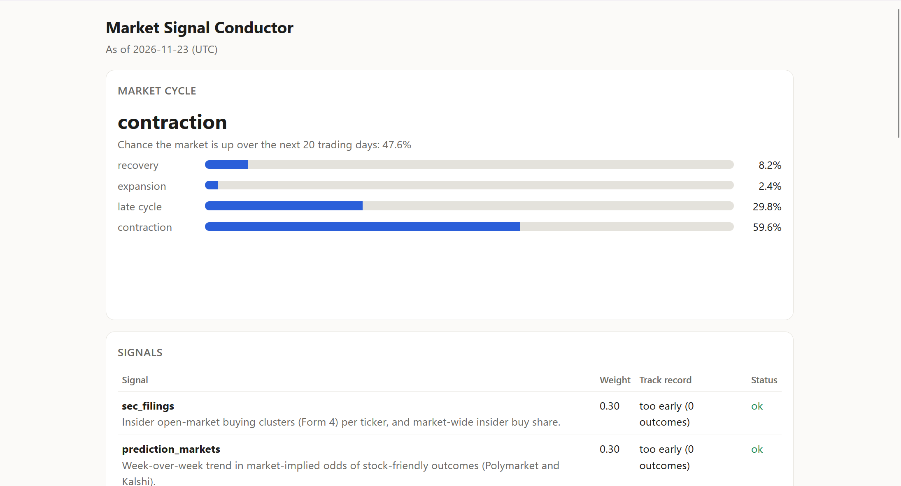
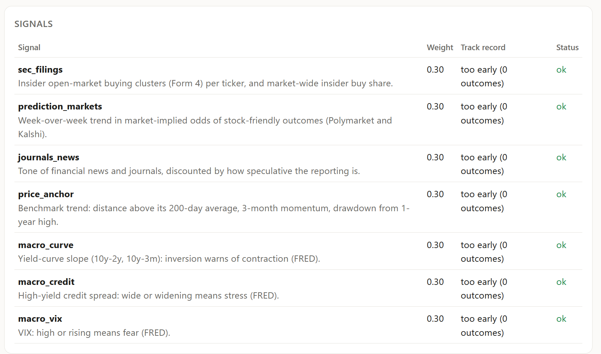
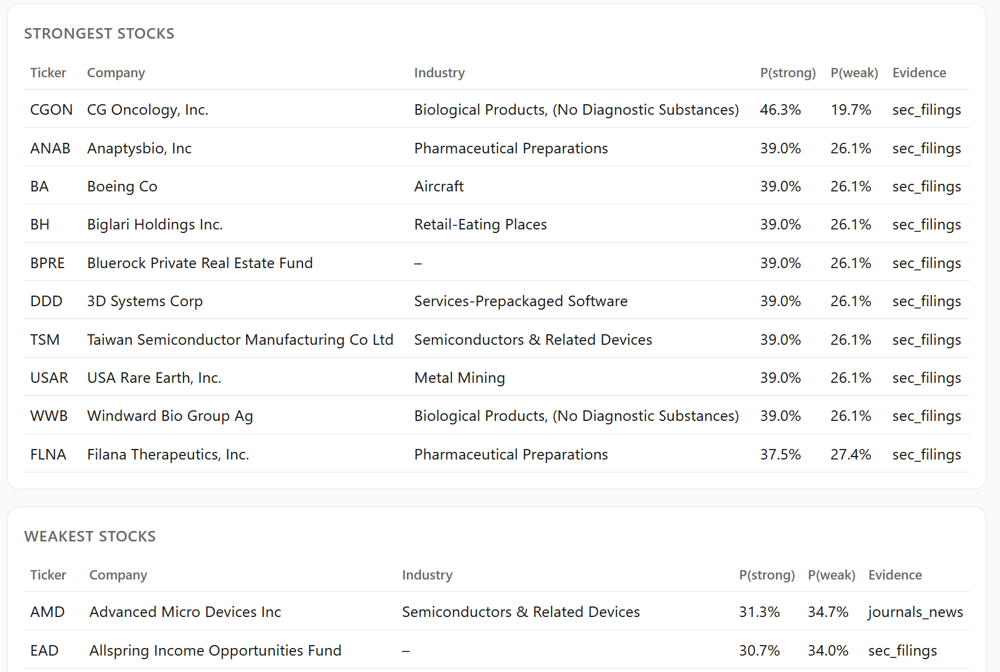

# Market Signal Conductor








> **At a glance:** Python (standard library only), about 3000 lines including tests, 134 tests, deployed on Fly.io. A hidden Markov
> model over a market cycle, plug-in data signals, outcome-based reliability weights and a coded evidence gate
> before any trading. [Vision](VISION.md) | [Architecture](docs/ARCHITECTURE.md) | [Operations](docs/OPERATIONS.md)

A web service that gathers market signals every day, feeds them into a layered Markov cycle model, and shows the
result on a password-protected dashboard. It runs on a host, so it keeps working when your computer is off.

**Start with the [vision](VISION.md). Design is in [docs/ARCHITECTURE.md](docs/ARCHITECTURE.md) and running it is in [docs/OPERATIONS.md](docs/OPERATIONS.md).**

**It places no orders and contains no broker code.** `msc/execution/gate.py` defines the evidence the model's own
forecasts must show before any trading code is added.

## How it works

```
signals (plugins) --> observations --> Markov core --> dashboard
 sec_filings          score in [-1,1]   Layer 1: market cycle (hidden states:
 prediction_markets   confidence [0,1]    recovery > expansion > late_cycle > contraction)
 social                                 Layer 2: each stock weak / neutral / strong,
 journals_news                            with odds tilted by the market cycle
 price_anchor                           Reliability weights: each signal earns influence from its
 (your own...)                            track record against what the market did next
```

- **Reliability weights.** A signal starts with a low weight (0.30). Once it has 12+ market readings whose
  outcome is already known, its weight moves with its correlation to the benchmark's next 20 days (shrunk toward
  zero for small samples). Wrong-way signals fall to 0. Only outcomes already known on the evaluation day are used.
- **Learning.** `python -m msc learn` re-fits the transition matrix, each signal's state means and P(market up)
  per state from stored history (EM with pseudo-counts that anchor it to the starting values).
- **Track record.** Every day's forecast is stored and scored once its 20 trading days have passed. The trading
  gate needs 60+ scored forecasts, a better Brier score than the base rate, and a hit rate whose 95% lower bound
  is above 50%.

## Signals

| Signal | Source | Needs |
| --- | --- | --- |
| `sec_filings` | SEC EDGAR Form 4 daily index: insider buying clusters per ticker; market-wide buy share | `SEC_USER_AGENT` with your email |
| `earnings_drift` | SEC XBRL company-concept API: diluted EPS vs the same quarter a year earlier (the year-ago figure from the same filing, so splits cancel), standardized by its own eight-quarter history. Per ticker for about a quarter after the 10-Q/10-K is filed; market-wide surprise breadth. Companies in `MSC_EARNINGS_TICKERS` (default: the watchlist). Replayable by filing date, opt-in for the backfill | `SEC_USER_AGENT` with your email |
| `prediction_markets` | Polymarket (Gamma API) and Kalshi (public market data): week-over-week change in odds of stock-friendly outcomes, tracked per venue | nothing (rules in `MSC_PM_RULES`, venues in `MSC_PM_VENUES`) |
| `social` | Public Reddit RSS: tone of cashtag chatter | nothing |
| `journals_news` | RSS feeds (`MSC_RSS_FEEDS`): tone, discounted by speculative wording | nothing |
| `macro_curve`, `macro_credit`, `macro_vix` | FRED free CSV downloads: yield-curve slope (T10Y2Y, T10Y3M), high-yield spread (BAMLH0A0HYM2), VIX (VIXCLS). Separate signals so each earns its own weight | nothing |
| `macro_labor`, `macro_conditions` | FRED weekly series: initial jobless claims (ICSA, 4-week average) and the Chicago Fed financial conditions index (NFCI). Used only from 5 days after their date (release delay). Stress is bearish; weights decide how far each is trusted | nothing |
| `price_anchor` | S&P 500 closes from FRED (default; `MSC_PRICE_SOURCE=stooq` to switch): benchmark trend, anchors the cycle states. The same prices score every forecast | nothing |
| `anomaly_flow` | Built from the other signals' stored data and the benchmark price: flags an unusually large one-day jump in prediction-market odds or benchmark price (z-score against its own recent history). Low confidence, runs last, logs each flagged event for later review. Does not see single options trades (that needs a paid feed) | nothing |

To see how the model would have done on past data, run `python -m msc backfill` (macro series and S&P 500 only, kept in a separate database, never counted toward the gate). See `docs/OPERATIONS.md`.

### Adding a signal

Copy `msc/signals/_template.py`, implement `collect()`, set `MSC_EXTRA_MODULES=your.module`. Paid sources
(a news API, Kalshi, a premium sentiment feed) are added the same way; read the key from the environment.

## Run locally

```
copy .env.example .env      (edit it)
python -m unittest discover -s tests -t .
python -m msc run-once      (one day's collection and model update)
python -m msc serve         (dashboard at http://localhost:8080, user "admin")
```

Needs Python 3.10+ and nothing else (standard library only).

## Deploy on Fly.io

```
fly launch --no-deploy --copy-config      (pick a unique app name)
fly volumes create msc_data --size 1 --region ord
fly secrets set MSC_DASH_PASSWORD=... SEC_USER_AGENT="Your Name you@example.com"
fly deploy
```

One always-on machine runs the web server and the daily job (default 22:30 UTC, after the US close). A restart
after that time catches up the missed run. SQLite lives on the volume. Keep a single machine: two would each have
their own database.

## Company names and industries

The stock tables show each ticker's company name and industry (SEC's SIC description), looked up once from SEC EDGAR
and cached in the database. A failed lookup leaves the cells blank rather than breaking the page.

## Debugging a signal

`fly ssh console -C "python -m msc pm-debug recession"` shows how many markets each prediction venue returned and
which ones match a pattern, so you can tune `MSC_PM_RULES`. Each signal's dashboard row shows its last error.

## Honest status

- **Live-confirmed on a real deployment:** FRED macro signals, SEC Form 4 filings, RSS news, S&P 500 prices from
  FRED, and Polymarket and Kalshi market data (the rules were tuned against what both venues actually return).
- **Not working:** the Reddit `social` signal. Reddit blocks cloud hosts (404 and 429), so it is switched off in
  the deployment.
- **No edge has been shown.** The starting state means, transition probabilities and P(up) per state are
  assumptions. The system earns trust only through its stored, forward-scored forecasts. The first scores need 20
  trading days and the gate needs 60, so expect about four months before there is anything to judge. Earlier
  insider-copytrading and multi-signal backtests found no edge, which is why the track record is the product.
- Free social and news data are thin and crude (a small word list). They start with low influence for that reason.
- Prediction-market rules are plain text patterns with exclusions. Kalshi and Polymarket word questions differently,
  so check the `levels` shown for each signal and adjust `MSC_PM_RULES` when titles change.
- The per-stock layer reuses market-level signal reliability; stock-level reliability is not measured yet.
- This is a research tool, not financial advice.

## License

MIT. See [LICENSE](LICENSE).
