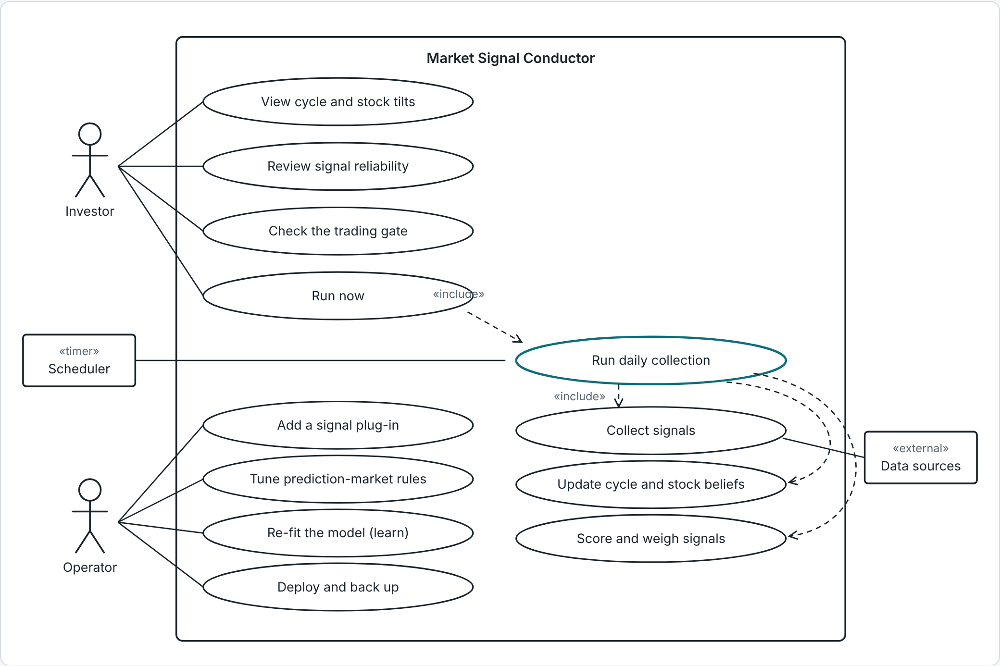
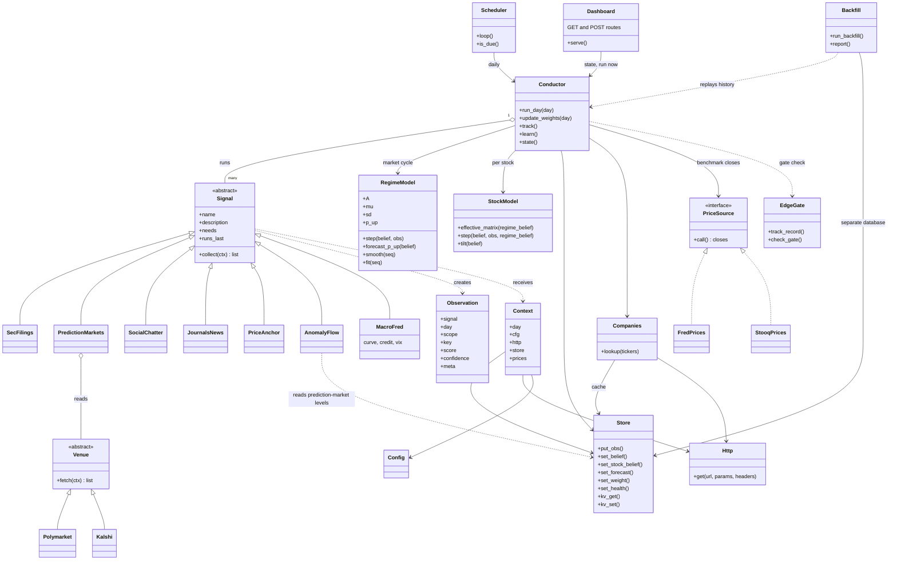
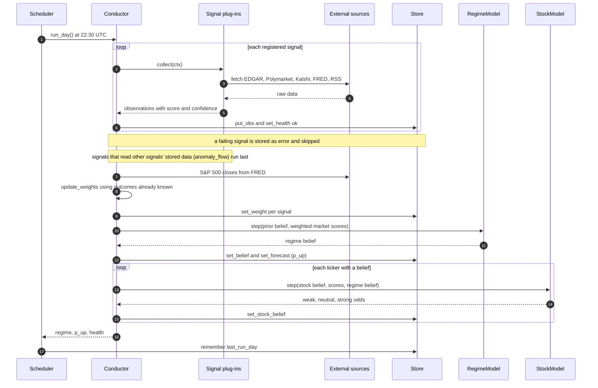
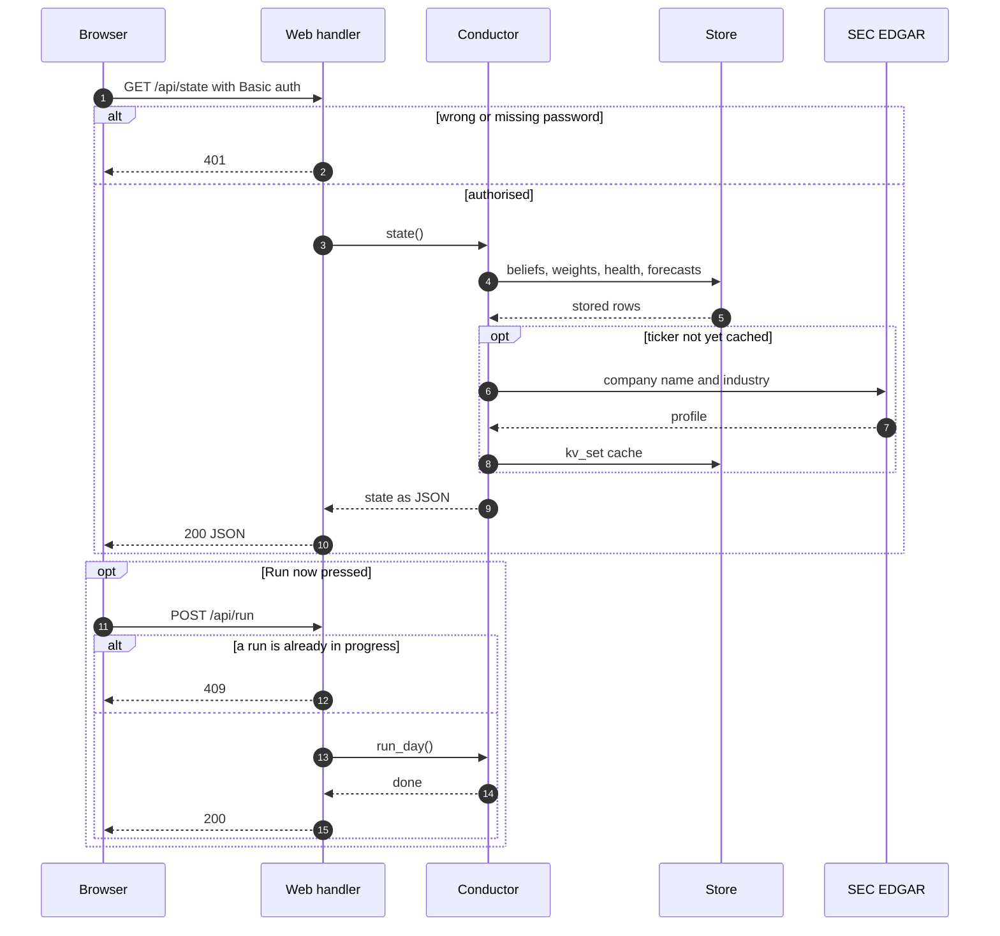

# Architecture

How the system is put together. The diagrams are drawn from the code; the Mermaid blocks render on GitHub.

## Overview

```
signals (plug-ins) --> observations --> Markov core --> store --> dashboard
 sec_filings            score  [-1, 1]   Layer 1: market regime
 prediction_markets     confidence [0,1]   recovery > expansion > late_cycle > contraction
 social                 scope: market      Layer 2: each stock weak / neutral / strong,
 journals_news          or ticker            odds tilted by the regime belief
 price_anchor                              Reliability weights: each signal's influence comes from
 macro_curve / _credit / _vix                its record against what the market did next
 anomaly_flow (runs last)
```

One process does everything: a standard-library HTTP server for the dashboard and a background thread that runs the
daily job at 22:30 UTC (after the US close). A restart after that time catches up the missed run.

## Use cases



The investor reads the dashboard and can press Run now. The scheduler triggers the daily run. The operator extends and
maintains the system. Run now takes the same code path as the timer. No trading actor exists: there is no order code.

## Classes



Config, Scheduler, Dashboard and EdgeGate are modules of functions in the code, drawn as classes for readability.

## Sequences

### The daily run



### A dashboard visit



## The model

**Layer 1, `RegimeModel`.** A hidden Markov chain over four states in a cycle. The transition prior is cyclic: stay
0.94, move forward 0.05, 0.005 for each other state. Each signal's market-level score is a Gaussian emission per
state (assumed means: recovery 0.30, expansion 0.50, late cycle 0.0, contraction -0.50; sd 0.45). Each signal's
log-likelihood is multiplied by its reliability weight, so an unproven signal barely moves the belief. Forward
filtering steps one day at a time; forward-backward smoothing and MAP-EM (`fit`) re-estimate the parameters from
history. Assumed P(market up over the horizon) per state: 0.62, 0.60, 0.52, 0.42.

**Layer 2, `StockModel`.** Three states per ticker (weak, neutral, strong). The transition matrix is a mixture of
regime-specific matrices weighted by the layer-1 belief. A stock's tilt is P(strong) minus P(weak). Stocks with no
evidence drift back toward neutral, and the dashboard lists only tickers with evidence in the last 30 days.

**Reliability weights (`weights.py`).** Start at 0.30. After at least 12 market-level readings with a known outcome,
weight = clip(0.30 + 3 x shrunk correlation, 0, 1), where the correlation is between a signal's past scores and the
benchmark's next-20-day return, shrunk by n / (n + 30). Only outcomes known on the evaluation day are used.

**The gate (`execution/gate.py`).** At least 60 scored forecasts, a better Brier score than the base rate, and a
Wilson 95% lower bound on the hit rate above 0.5. No broker or order code exists anywhere.

## Data model (SQLite)

| Table | Holds |
| --- | --- |
| `observations` | Every signal reading: signal, day, scope, key, score, confidence, meta |
| `regime_beliefs` | Daily market-regime belief, P(up) and the most likely regime |
| `stock_beliefs` | Daily weak / neutral / strong belief and tilt per ticker |
| `signal_health` | Last status and error text for each signal |
| `signal_weights` | Reliability weight, sample size and correlation per signal and day |
| `forecasts` | Each day's stored forecast, scored once its horizon has passed |
| `kv` | Small JSON values: fitted model, last run day, prediction-market history, company cache |

## Signals

| Signal | Source | Reads |
| --- | --- | --- |
| `sec_filings` | SEC EDGAR daily Form 4 index and XML | Insider open-market buying clusters per ticker; market-wide buy share |
| `prediction_markets` | Polymarket Gamma API, Kalshi public market data | Week-over-week change in odds of stock-friendly outcomes (recession, Fed cuts, Fed hikes) |
| `social` | Reddit RSS | Tone of cashtag chatter (currently blocked from cloud hosts) |
| `journals_news` | RSS feeds | Tone, discounted by speculative wording |
| `price_anchor` | FRED SP500 | Benchmark trend, momentum and drawdown |
| `anomaly_flow` | Stored prediction-market levels, FRED SP500 | Unusual one-day jumps (z-score vs the series' own recent changes); runs last; each flag is logged under kv `anomaly:<day>` |
| `macro_curve`, `macro_credit`, `macro_vix` | FRED CSV downloads | Yield-curve slope, high-yield spread, VIX |

A signal is any subclass of `Signal` that returns `Observation` objects, registered with `@register`. Extra modules
load through `MSC_EXTRA_MODULES`. See `msc/signals/_template.py`.

## Backfill

`python -m msc backfill` replays the replayable signals (FRED macro series and the S&P 500 trend) over past days
through the same `Conductor`, into a separate database. It exists to show how the model would have done, not to
feed the gate. Rules: the live database is never written; each replayed day's reliability weights use only
outcomes known by that day (`compute_weights` ignores prices after the evaluation day); the model is not re-fit on
the replayed data. The report also lists which signals move together (`signal_overlap`), because the model combines
signals as if independent.

## Design decisions

| Decision | Why | Cost |
| --- | --- | --- |
| Standard library only | Nothing to install or patch; one Dockerfile line | Hand-rolled HTTP server and parsers |
| SQLite on one volume | Simple, cheap, easy to back up | Exactly one machine; no high availability |
| In-process scheduler | No second service or cron host | The machine must stay running; restart catch-up covers gaps |
| Basic auth with one password | Enough for one user | Not a multi-user system |
| Plug-in signals with independent failure | Free sources break often | Every signal needs its own error text |
| Signals combined as independent evidence | Simple and transparent; each signal has its own weight and regime means | Correlated signals partly double-count: the overlap report shows which |
| Weights learned from outcomes, not set by hand | Keeps unproven signals quiet | Slow: needs months of data |
| Gate in code, not policy | The evidence bar cannot be skipped by accident | Live trading needs a deliberate change |
